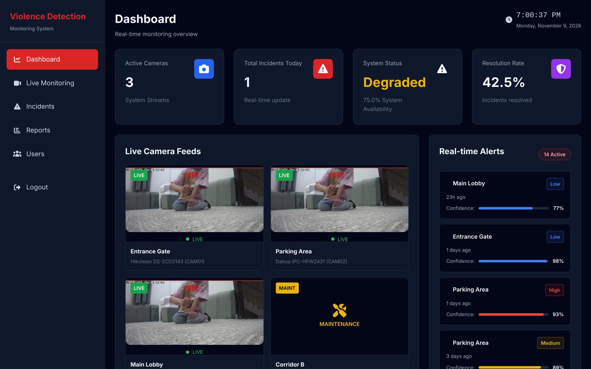
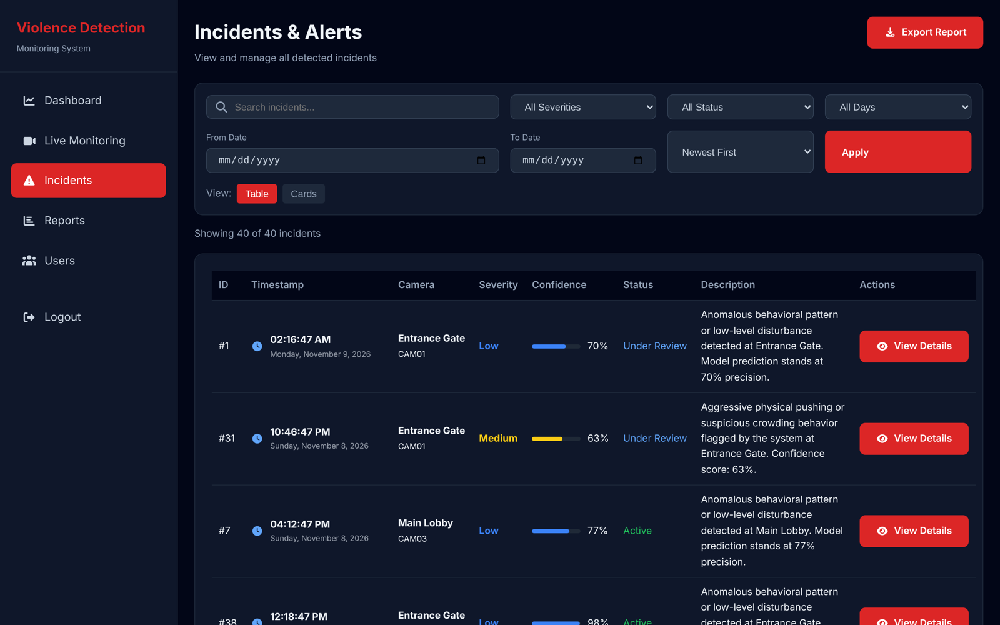
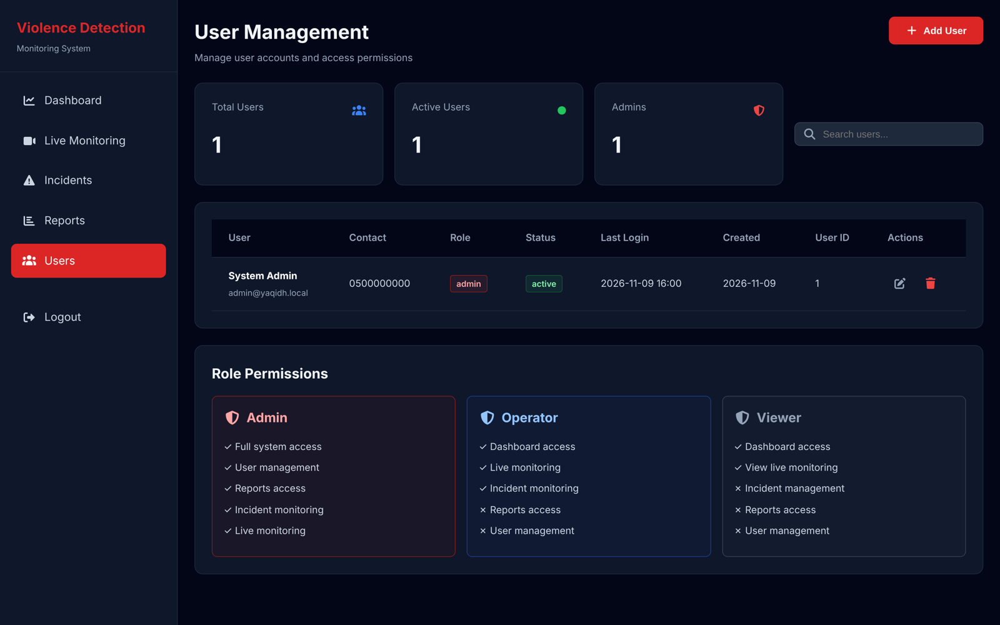

# Yaqidh (يقظ) – Violence Detection Monitoring Platform

Yaqidh is a real-time violence detection system for surveillance cameras, built as a graduation project at **Qassim University** by a team of six (2026).

A deep-learning pipeline watches camera streams and records violent events. **This repository is the web platform** that security staff use to monitor cameras, review incidents and manage access.

> **My role:** I built this platform end to end (Django backend + frontend) and integrated it with the team's detection pipeline. Other team members handled the detection model (based on a pre-trained model), the alerting service and the database design. Those parts are not included in this repo.



---

## Features

**Authentication & security**
- Email + password login with hashed passwords (Django PBKDF2)
- First-login flow: temporary password → one-time verification code (OTP) by email → mandatory password change
- OTP expiry and a limit on wrong attempts
- Session-based auth with session-key rotation on login

**Role-based access control**

| | Admin | Operator | Viewer |
|---|:-:|:-:|:-:|
| Dashboard & live monitoring | ✓ | ✓ | ✓ |
| Incidents (view, review, resolve, export) | ✓ | ✓ | – |
| Reports & analytics | ✓ | – | – |
| User management | ✓ | – | – |

Permissions are enforced on the server for every page and action, not only hidden in the menu.

**Monitoring**
- Live dashboard that refreshes every 5 seconds through a JSON endpoint, without reloading the page
- Live camera view that shows the processed frames from the detection pipeline
- System status from camera health (Operational / Degraded / Offline)

**Incident management**
- Incident lifecycle: `Active → Under Review` (when someone opens it) `→ Resolved`
- Search and filters by severity, status, date range and weekday
- Auto-generated description from the model's output and confidence
- CSV export that respects the active filters

**Reports**
- Incidents by weekday, hour and camera; severity distribution
- Peak hour, most active camera, resolution rate and week-over-week change

**User management (admin)**
- Add, edit, delete and activate/deactivate users (AJAX)
- Input validation (Saudi phone format, Arabic/English names, email)
- New users get a random temporary password and verification code by email

| Incidents | Users |
|---|---|
|  |  |

---

## How it connects to the detection model

The platform and the AI pipeline are **decoupled**. They share a MySQL database and a frames folder, so each side can run, crash or restart without taking the other down.

```
Camera (RTSP) ──► Detection pipeline (built by teammates)
                        │                                   │
              writes incidents                  writes latest processed frame
                        ▼                                   ▼
             MySQL: violence_events            apps/static/live_frames/cam1.jpg
                        │                                   │
                        └──────────► Yaqidh platform ◄──────┘
                                     (this repo, Django)
                          • dashboard polls /dashboard/api/live/ every 5 s
                          • live view refreshes the frame every 400 ms
```

The pipeline inserts rows into `violence_events` (`Camera_ID`, `Timestamp`, `location`, `Severity`, `Confidence`, `evidence`, `status`). The platform reads them, tracks their status and turns them into dashboards and reports.

---

## Database

The platform reads from a shared MySQL database whose schema was designed by the team's database members.

When you run the project without the team's database, `python manage.py migrate` creates the tables the platform needs from the Django models.

---

## Tech stack

Python · Django 4.2 · MySQL (PyMySQL) · HTML/CSS/JavaScript · Chart.js · Font Awesome

---

## Run it locally

### Quick demo (SQLite, no MySQL needed)

```bash
git clone https://github.com/Reema2N/yaqidh-platform.git
cd yaqidh-platform

python -m venv venv
venv\Scripts\activate          # Windows
# source venv/bin/activate     # macOS / Linux

pip install -r requirements.txt

copy .env.example .env         # Windows  (cp on macOS / Linux)
# then set DB_ENGINE=sqlite in .env

python manage.py migrate
python manage.py create_admin --email admin@example.com
python manage.py seed_demo     # optional: demo cameras + incidents
python manage.py runserver
```

Open http://127.0.0.1:8000 and sign in with the admin account you created.

**See it working live without cameras or the AI model.** In a second terminal, run:

```bash
python manage.py simulate_detection
```

This stands in for the detection pipeline. It writes a sample camera frame and inserts a new incident every few seconds, so you can watch alerts and pop-ups appear on the dashboard. Press Ctrl+C to stop. Options: `--interval 3`, `--count 10`.

Without email settings, OTP emails are printed in the terminal, so you can still try the first-login flow for new users.

### With MySQL (shared with the detection pipeline)

1. Create the database: `CREATE DATABASE violence_system_db CHARACTER SET utf8mb4;`
2. In `.env`, set `DB_ENGINE=mysql` and fill in `DB_USER` / `DB_PASSWORD`.
3. Run `python manage.py migrate`. It creates any missing tables and leaves existing ones untouched.
4. Set `MEDIA_ROOT` to the folder where the pipeline saves evidence files.
5. Optional sample data: `mysql -u root -p violence_system_db < sql/sample_violence_events.sql`

### Run the tests

```bash
python manage.py test
```

There are 20 tests covering login, the first-login/OTP flow, role permissions, user management, the management commands and page rendering.

---

## Project structure

```
Violence/              Django project settings and URL routing
apps/
  core/                login, OTP, password change, and the create_admin /
                       seed_demo / simulate_detection commands
  dashboard/           dashboard page + live JSON API
  incidents/           incident list, details, status changes, CSV export
  live_monitoring/     live camera view
  reports/             analytics and charts
  users/               user management (admin)
  templates/           HTML templates
  static/              CSS, JavaScript, images
sql/                   sample data
docs/                  README screenshots and the demo camera frame
```

---

## Ideas for future work

- Show several cameras at once on the live page (currently one processed stream)
- Push updates with WebSockets (Django Channels) instead of polling
- Self-service "resend verification code"
- Move to Django's built-in `User` model to use its auth and permission tools

---

Built by [Reema](https://github.com/Reema2N) · [LinkedIn](https://www.linkedin.com/in/reema-nassr) · [Portfolio](https://reema-nasser.vercel.app)
